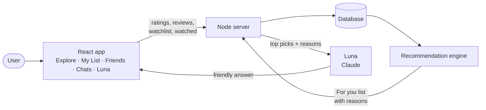
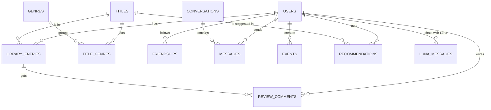
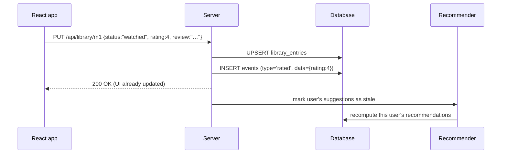
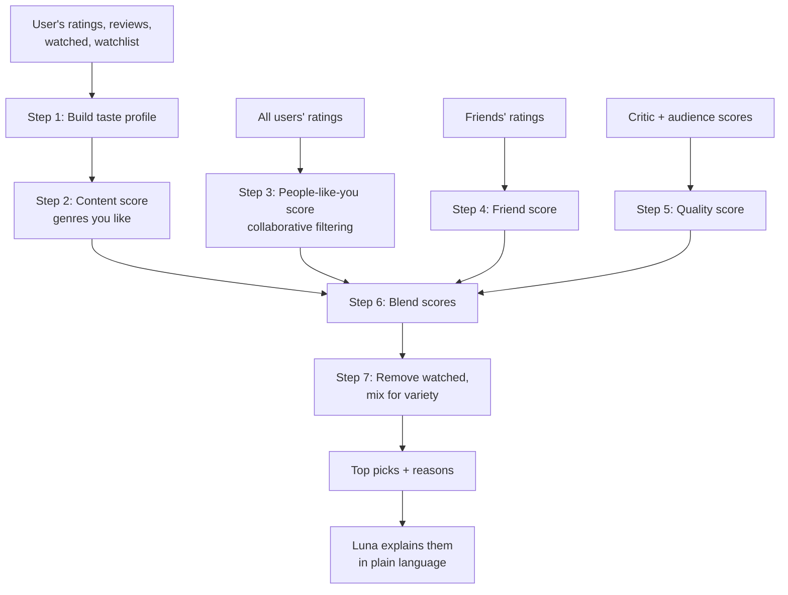

# How Grab the Popcorn Works

This doc explains how the app works today, how it will store everything a user does in a database, and how the recommendation system picks what to suggest next.

- [1. The big picture](#1-the-big-picture)
- [2. What the user puts in](#2-what-the-user-puts-in)
- [3. How it works today](#3-how-it-works-today)
- [4. The database](#4-the-database)
- [5. The API](#5-the-api)
- [6. The recommendation system](#6-the-recommendation-system)
- [7. How Luna fits in](#7-how-luna-fits-in)
- [8. Moving from today to the database](#8-moving-from-today-to-the-database)
- [9. Build plan](#9-build-plan)

> **Status.** Sections 1–3 describe what is built. Sections 4–9 are the design for what comes next: the database, the API and the recommendation system are not built yet.

---

## 1. The big picture

Grab the Popcorn is a place to keep track of movies and shows, rate and review them, chat with friends about them, and get suggestions on what to watch next.



Every action the user takes (rate, review, add to watchlist, mark watched, add a friend) is saved. The recommendation engine reads those saved actions and scores every title the user hasn't seen yet. Luna uses those scores to answer in plain language.

---

## 2. What the user puts in

| Input | Where in the app | What it means for recommendations |
|---|---|---|
| **Star rating** (1–5) | Title page → "Your review" | Strongest signal. 4–5 = liked, 1–2 = disliked. |
| **Review / comment** (text) | Title page → "Your review" | Explains *why*. Used as a backup signal when there is no star rating. |
| **Watched** | Title page → "✓ Watched" | User has seen it. Never recommend it again. Weak "liked" signal if not rated. |
| **Watchlist** | Title page → "+ Watchlist" | User wants to see it. Shown in its own row, and counts as a weak "interested" signal. |
| **Remove** | Title page → "Remove" | Drops the entry. |
| **Friends** | Friends page → "+ Add" | Friends' taste adds a "social" boost to titles they loved. |
| **Chat messages** | Chats page | Stored for the conversation. Not used for recommendations. |
| **Questions to Luna** | Luna page | Stored as the Luna conversation. |
| **Searches and filters** | Explore page | Not stored today. Could be logged later as a light interest signal. |

---

## 3. How it works today

### Pieces

| Part | File(s) | Job |
|---|---|---|
| Pages | `src/pages/*.jsx` | Explore, Title detail, My List, Friends, Chats, Luna |
| App state | `src/store.jsx` | Holds the user's list, friends, chats and Luna chat, and saves them |
| Sample data | `src/data.js` | 16 movies/shows and 5 sample people |
| Router | `src/router.js` | Hash-based routes like `#/title/m1` |
| Luna (browser) | `src/luna.js` | Sends the chat to the server and streams the reply back |
| Luna (server) | `server/luna.js` | Calls Claude with the catalog and the user's list; keeps the API key server-side |
| Server | `server/index.js`, `vite.config.js` | Serves the app and `POST /api/luna` |

### Where data lives today

Everything the user does is saved in the **browser's localStorage** under the key `popcorn-state-v1`:

```js
{
  library: {
    "m1": { status: "watched",   rating: 4, review: "Huge, loud, perfect.", addedAt: 1729660000000 },
    "s2": { status: "watchlist", rating: 0, review: "",                     addedAt: 1729660500000 }
  },
  friends: ["u1", "u2"],
  chats: {
    "u1": [{ from: "me", text: "What did you think of Dune?", titleId: "m1", ts: 1729660100000 }]
  },
  luna: [{ role: "user", content: "What should I watch tonight?" }, { role: "assistant", content: "…" }]
}
```

This is fine for a demo, but it has limits:

- Data stays on one device and one browser, and is lost if the browser is cleared.
- There are no real accounts, so friends and chats are simulated.
- Recommendations can only use one person's data, so "people like you also liked…" isn't possible.

The database below fixes all three.

---

## 4. The database

**Recommended:** PostgreSQL. SQLite is fine to start with, since the schema below works in both with small changes.

### Tables at a glance



### The key table: `library_entries`

One row per user per title. This single table holds **watchlist, watched, rating and review**.

| Column | Example | Meaning |
|---|---|---|
| `status` | `watched` / `watchlist` | Where the title sits in My List |
| `rating` | `4` (or empty) | 1–5 stars, optional |
| `review` | "Huge, loud, perfect." | The user's comment, optional |
| `watched_at` | 2026-10-20 | When they marked it watched |
| `added_at`, `updated_at` | timestamps | For sorting and for "recent taste" |

### Full schema (PostgreSQL)

```sql
-- People
CREATE TABLE users (
  id            BIGSERIAL PRIMARY KEY,
  handle        TEXT UNIQUE NOT NULL,          -- @mayawatches
  name          TEXT NOT NULL,
  bio           TEXT DEFAULT '',
  email         TEXT UNIQUE NOT NULL,
  created_at    TIMESTAMPTZ NOT NULL DEFAULT now()
);

-- Movies and shows (later filled from a movie API such as TMDB)
CREATE TABLE titles (
  id            BIGSERIAL PRIMARY KEY,
  external_id   TEXT UNIQUE,                   -- e.g. TMDB id
  kind          TEXT NOT NULL CHECK (kind IN ('movie', 'show')),
  title         TEXT NOT NULL,
  year          INT,
  synopsis      TEXT,
  poster_url    TEXT,
  critics_score INT CHECK (critics_score BETWEEN 0 AND 100),
  audience_score INT CHECK (audience_score BETWEEN 0 AND 100)
);

CREATE TABLE genres (
  id    SERIAL PRIMARY KEY,
  name  TEXT UNIQUE NOT NULL                   -- 'Sci-Fi', 'Drama', ...
);

CREATE TABLE title_genres (
  title_id  BIGINT REFERENCES titles(id) ON DELETE CASCADE,
  genre_id  INT    REFERENCES genres(id) ON DELETE CASCADE,
  PRIMARY KEY (title_id, genre_id)
);

-- Watchlist + watched + rating + review, one row per user per title
CREATE TABLE library_entries (
  user_id     BIGINT REFERENCES users(id)  ON DELETE CASCADE,
  title_id    BIGINT REFERENCES titles(id) ON DELETE CASCADE,
  status      TEXT NOT NULL CHECK (status IN ('watchlist', 'watched')),
  rating      SMALLINT CHECK (rating BETWEEN 1 AND 5),   -- NULL = not rated
  review      TEXT,                                      -- NULL = no comment
  watched_at  TIMESTAMPTZ,
  added_at    TIMESTAMPTZ NOT NULL DEFAULT now(),
  updated_at  TIMESTAMPTZ NOT NULL DEFAULT now(),
  PRIMARY KEY (user_id, title_id)
);
CREATE INDEX library_by_title ON library_entries (title_id);

-- Friends comment on each other's reviews
CREATE TABLE review_comments (
  id             BIGSERIAL PRIMARY KEY,
  review_user_id BIGINT NOT NULL,
  title_id       BIGINT NOT NULL,
  author_id      BIGINT NOT NULL REFERENCES users(id) ON DELETE CASCADE,
  body           TEXT NOT NULL,
  created_at     TIMESTAMPTZ NOT NULL DEFAULT now(),
  FOREIGN KEY (review_user_id, title_id) REFERENCES library_entries(user_id, title_id) ON DELETE CASCADE
);

-- One-way follow; a "friend" is a follow in both directions
CREATE TABLE friendships (
  user_id     BIGINT REFERENCES users(id) ON DELETE CASCADE,
  friend_id   BIGINT REFERENCES users(id) ON DELETE CASCADE,
  created_at  TIMESTAMPTZ NOT NULL DEFAULT now(),
  PRIMARY KEY (user_id, friend_id),
  CHECK (user_id <> friend_id)
);

-- Friend chats
CREATE TABLE conversations (
  id          BIGSERIAL PRIMARY KEY,
  created_at  TIMESTAMPTZ NOT NULL DEFAULT now()
);
CREATE TABLE conversation_members (
  conversation_id BIGINT REFERENCES conversations(id) ON DELETE CASCADE,
  user_id         BIGINT REFERENCES users(id) ON DELETE CASCADE,
  PRIMARY KEY (conversation_id, user_id)
);
CREATE TABLE messages (
  id              BIGSERIAL PRIMARY KEY,
  conversation_id BIGINT NOT NULL REFERENCES conversations(id) ON DELETE CASCADE,
  sender_id       BIGINT NOT NULL REFERENCES users(id),
  body            TEXT NOT NULL,
  title_id        BIGINT REFERENCES titles(id),   -- optional attached movie card
  sent_at         TIMESTAMPTZ NOT NULL DEFAULT now()
);
CREATE INDEX messages_by_conversation ON messages (conversation_id, sent_at);

-- Luna conversation history
CREATE TABLE luna_messages (
  id        BIGSERIAL PRIMARY KEY,
  user_id   BIGINT NOT NULL REFERENCES users(id) ON DELETE CASCADE,
  role      TEXT NOT NULL CHECK (role IN ('user', 'assistant')),
  content   TEXT NOT NULL,
  sent_at   TIMESTAMPTZ NOT NULL DEFAULT now()
);

-- Append-only log of everything the user does (history + training data)
CREATE TABLE events (
  id         BIGSERIAL PRIMARY KEY,
  user_id    BIGINT NOT NULL REFERENCES users(id) ON DELETE CASCADE,
  type       TEXT NOT NULL,      -- 'rated', 'reviewed', 'watchlisted', 'watched', 'removed', 'friended', 'opened_title', 'searched'
  title_id   BIGINT REFERENCES titles(id),
  data       JSONB DEFAULT '{}', -- e.g. {"rating": 4} or {"query": "dune"}
  created_at TIMESTAMPTZ NOT NULL DEFAULT now()
);
CREATE INDEX events_by_user ON events (user_id, created_at DESC);

-- Precomputed suggestions, refreshed by the recommendation job
CREATE TABLE recommendations (
  user_id      BIGINT REFERENCES users(id)  ON DELETE CASCADE,
  title_id     BIGINT REFERENCES titles(id) ON DELETE CASCADE,
  score        REAL NOT NULL,        -- 0..1
  reasons      JSONB NOT NULL,       -- ["Because you rated Dune: Part Two 5★", "Maya loved it"]
  computed_at  TIMESTAMPTZ NOT NULL DEFAULT now(),
  PRIMARY KEY (user_id, title_id)
);
```

### Why two places for the same action?

- `library_entries` holds the **current state**: "Dune is watched and rated 4."
- `events` holds the **history**: "rated 3 on Monday, changed to 4 on Friday."

The app reads `library_entries` to draw the screens. The recommendation system can use `events` to weight recent taste more heavily, and to measure how good its suggestions are.

### What happens when a user rates a movie



The UI updates straight away and the server saves in the background (an "optimistic update"). If the save fails, the UI rolls back and shows an error.

---

## 5. The API

All routes need a signed-in user, and `me` means the current user.

| Method & path | What it does |
|---|---|
| `GET /api/titles?q=&kind=&genre=` | Search and filter the catalog |
| `GET /api/titles/:id` | One title, with friends who rated it |
| `GET /api/me/library?status=watched` | My List (watched or watchlist) |
| `PUT /api/me/library/:titleId` | Add or update: `{status, rating, review}` |
| `DELETE /api/me/library/:titleId` | Remove from My List |
| `GET /api/users?q=` | Search people by name or @handle |
| `POST /api/me/friends/:userId` · `DELETE …` | Add or remove a friend |
| `GET /api/conversations` · `POST /api/conversations/:id/messages` | Friend chats (live updates via WebSocket) |
| `POST /api/reviews/:userId/:titleId/comments` | Comment on a friend's review |
| `GET /api/me/recommendations?limit=20` | "For you" list with reasons |
| `POST /api/luna` | Ask Luna (already built, streams text) |

---

## 6. The recommendation system

### Goal

For each user, rank every title they **haven't watched** and explain why each one is suggested ("Because you rated Dune 5★", "Maya loved it").

### How it works in one picture



### Step 0: Turn every input into a number

Each library entry gets a **signal** between −2 and +2, centred on "neutral" (3 stars):

| Input | Signal | Why |
|---|---|---|
| Rated 5★ | +2 | Loved it |
| Rated 4★ | +1 | Liked it |
| Rated 3★ | 0 | Neutral |
| Rated 2★ | −1 | Disliked it |
| Rated 1★ | −2 | Hated it |
| Watched, no rating, has review | from review sentiment (−2…+2) | Claude reads the comment and scores it |
| Watched, no rating, no review | +0.5 | Finished it, so probably okay |
| On watchlist | +0.5 | Interested, but hasn't seen it |

Newer entries count a bit more, since taste changes over time:

```
weight = 0.5 ^ (days_since_entry / 180)      # halves every 6 months
```

### Step 1: Taste profile (which genres you like)

For each genre, average the signals of the titles you have in that genre:

```
taste[genre] = Σ (signal × weight)  /  Σ weight      over your titles in that genre
```

This lands between −2 (avoid) and +2 (love). Genres you haven't touched count as 0.

### Step 2: Content score (does this title match your genres?)

```
content(title) = average of taste[g] for each genre g of the title    # −2…+2
content01      = (content + 2) / 4                                    # 0…1
```

### Step 3: People-like-you score (collaborative filtering)

"Users who rated the same things you did also loved X." This uses **item-to-item similarity**: two titles are similar if the same people rate them the same way.

```
sim(A, B) = cosine similarity of the signal columns of A and B
            (only over users who have both)

predict(you, X) = Σ sim(X, Y) × your_signal(Y)  /  Σ |sim(X, Y)|
                  over titles Y you have a signal for, keeping the top 20 most similar

collab01 = (predict + 2) / 4
```

The similarity table only needs updating occasionally (for example nightly), because it changes slowly. In SQL:

```sql
-- signal = rating - 3 (unrated entries use the fallbacks above)
WITH s AS (
  SELECT user_id, title_id, (rating - 3)::float AS v
  FROM library_entries WHERE rating IS NOT NULL
)
SELECT a.title_id AS a, b.title_id AS b,
       SUM(a.v * b.v) / (sqrt(SUM(a.v * a.v)) * sqrt(SUM(b.v * b.v)) + 1e-9) AS sim,
       COUNT(*) AS overlap
FROM s a JOIN s b ON a.user_id = b.user_id AND a.title_id < b.title_id
GROUP BY a.title_id, b.title_id
HAVING COUNT(*) >= 3;          -- ignore pairs with too few shared users
```

**Cold start:** with only a few users there isn't enough overlap, so this score is skipped (see the weights below) until at least about 50 users have rated 10 or more titles.

### Step 4: Friend score

```
friend(title) = (number of your friends who rated it 4★+ or marked it a favourite)
                / (number of your friends)
```

A friend who rated it 1–2★ subtracts instead, so the score can go below 0 and is then clamped to 0.

### Step 5: Quality score

A small nudge toward titles that are well liked in general:

```
quality(title) = (critics_score + audience_score) / 200       # 0…1
```

### Step 6: Blend

```
score = 0.40 × content01
      + 0.25 × collab01
      + 0.20 × friend
      + 0.15 × quality
```

If a part can't be computed (for example `collab` during cold start), drop it and scale the other weights up so they still add to 1.

### Step 7: Clean up the list

1. **Remove** titles already marked watched.
2. **Watchlist** titles go in their own "From your watchlist" row, ranked by the same score, instead of in "For you".
3. **Variety:** don't show more than 3 titles in a row from the same main genre. Pick the next best title from a different genre instead.
4. **Reasons:** keep the top 1–2 things that pushed the score up, as text:
   - biggest content match → *"Because you liked Sci-Fi like Dune: Part Two"*
   - biggest collab neighbour → *"People who loved Interstellar loved this"*
   - friend → *"Maya and Leo rated it 5★"*
   - quality → *"99% with critics"*

### Worked example

Our user has rated three titles. Their friends are Maya and Leo.

| Title | Genres | Rating | Signal |
|---|---|---|---|
| Dune: Part Two | Sci-Fi, Adventure | 5★ | +2 |
| Interstellar | Sci-Fi, Drama | 4★ | +1 |
| Past Lives | Drama, Romance | 2★ | −1 |

**Taste profile:** Sci-Fi = (2 + 1) / 2 = **+1.5** · Adventure = **+2** · Drama = (1 − 1) / 2 = **0** · Romance = **−1**. Every other genre is 0.

Not enough users exist yet, so `collab` is dropped and the weights become content 0.53, friend 0.27, quality 0.20.

| Candidate | Content | Friend | Quality | **Score** |
|---|---|---|---|---|
| Everything Everywhere All at Once (Sci-Fi, Comedy) | (1.5 + 0)/2 = 0.75 → **0.69** | Maya loved it → 1/2 = **0.50** | (94 + 86)/200 = **0.90** | 0.53×0.69 + 0.27×0.50 + 0.20×0.90 = **0.68** |
| Severance (Thriller, Sci-Fi) | (0 + 1.5)/2 = 0.75 → **0.69** | **0** | (97 + 92)/200 = **0.95** | 0.53×0.69 + 0 + 0.20×0.95 = **0.56** |
| Spirited Away (Animation, Fantasy) | 0 → **0.50** | **0** | (96 + 96)/200 = **0.96** | 0.53×0.50 + 0 + 0.20×0.96 = **0.46** |

**Result:** 1) *Everything Everywhere All at Once*: "Because you like Sci-Fi · Maya loved it". 2) *Severance*: "Because you like Sci-Fi like Dune: Part Two".

### When it runs

| Trigger | What gets recomputed |
|---|---|
| User rates, reviews, marks watched or edits the watchlist | That user's recommendations (fast, well under a second for thousands of titles) |
| User adds or removes a friend | That user's friend scores |
| Nightly job | Title-to-title similarity table, then everyone's recommendations |

Results go in the `recommendations` table, so the "For you" page is a single quick read.

### Checking that it works

- **Offline test:** hide each user's most recent 5★ rating, run the recommender, and check how often that title shows up in their top 10 (called "hit rate @10"). Compare it against a baseline that just sorts by quality score.
- **In the app:** track how often users click, watchlist or rate a suggested title (logged in `events`), and add a "Not interested" button that counts as a −1 signal.

---

## 7. How Luna fits in

Today Luna gets the catalog plus the user's list and friends, and reasons about them directly. Once the recommender exists:

1. The server fetches the user's **top 10 recommendations with reasons** from the database.
2. It adds them to Luna's context: *"Ranked picks for this user: 1. Everything Everywhere All at Once (0.68) — likes Sci-Fi, Maya loved it…"*
3. Luna answers the actual question ("something light for tonight", "a show to watch with Leo") by **choosing from and explaining** those picks, rather than ranking titles from scratch.

This keeps suggestions consistent between the "For you" page and Luna, and keeps Luna's prompts short. Luna is also how a review's sentiment gets scored (step 0) when the user left a comment but no stars.

---

## 8. Moving from today to the database

When a user signs in for the first time, the app checks localStorage for `popcorn-state-v1`. If it finds data, it sends it once to `POST /api/me/import`. That route:

1. Maps each sample title id (`m1`, `s2`, …) to the real `titles.id`.
2. Inserts `library_entries` (status, rating, review, added date) and matching `events`.
3. Adds friends and Luna history.
4. On success, the browser clears the local copy and uses the API from then on.

---

## 9. Build plan

| Phase | What | Result |
|---|---|---|
| 1 | Accounts + database + `library_entries` API; swap `store.jsx` from localStorage to the API | Lists, ratings and reviews saved for real across devices |
| 2 | Real catalog from a movie API (TMDB) into `titles` / `genres` | Real posters, thousands of titles |
| 3 | Content + friend + quality scoring, "For you" row on Explore, reasons | First version of recommendations |
| 4 | Real friends, live chat (WebSocket), comments on reviews | The social side becomes real |
| 5 | Collaborative filtering once there are enough users; nightly job; "Not interested" | Smarter "people like you" suggestions |
| 6 | Luna uses the recommender's picks (section 7) | Luna and "For you" agree |

### Privacy notes

- Reviews and ratings are visible to friends by default; add a per-entry "private" option.
- Luna only receives the signed-in user's own data, plus their friends' public favourites.
- "Delete my account" removes every row tied to the user (the `ON DELETE CASCADE` rules handle this).
